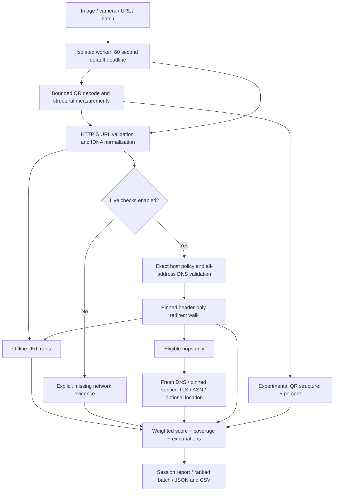

# Architecture and design decisions

The redirect trace precedes network inspection because the latter needs its hop list. No claim of simultaneous execution of dependent stages is made. Independent batch inputs run concurrently. The network collector independently revalidates fresh DNS data before its own TLS connection; the tracer's eligibility marker alone is insufficient.

## Design choices

- Python/OpenCV provides actual image decoding and a rectified QR matrix without a native zbar installation. Grayscale, thresholding, resizing and bounded right-angle fallback address observed decoder behavior.
- Deterministic URL and network rules expose evidence suitable for a Computer Networks viva. A separate optional logistic model supports experiments without obscuring the core score.
- Header-only manual redirects preserve every transition and retain blocked/failed hops. HTTPS uses a verified connection pinned to a validated IP with original-host SNI. Auto-redirects, JavaScript and HTML execution are not used.
- dnspython resolves A and AAAA inside one deadline and retains observed TTLs. An incomplete family lookup fails closed before connection. These are cache-observed TTLs, not authoritative domain ages.
- The standard ssl module performs certificate and hostname verification and supplies certificate dates, issuer, SHA-256, negotiated protocol/cipher/ALPN. Failed validation is negative evidence; transport failure is unavailable evidence. No CERT_NONE retry is used.
- Team Cymru DNS provides no-key ASN/organization enrichment. Registry country is distinct from optional approximate IP geolocation via ipwho.is. No invented malicious-provider list is maintained.
- Streamlit maintains completed reports in session state. Detail selection and input changes do not rerun scans. Camera capture is a still-photo workflow with an explicit scan button.

## Rule contributions

URL rules retain the original values: raw IP .25, brand in unrelated subdomain .40, one-edit brand .30, deep subdomains .10, long URL .05. A limited internationalized brand skeleton match adds .40. Punycode and watched TLDs alone add zero. For chains, take the highest URL sub-score.

Redirects: registered-domain transition .12 (first three), HTTPS downgrade .35, multiple shorteners .20, observed loop .20, long chains up to .20, supplied expected-domain mismatch .35. Add and cap at one.

Network: certificate validation failure .85, unencrypted HTTP .35, final inspected hop ASN baseline mismatch .20 and optional country baseline mismatch .05. Add within a hop, cap at one and take the maximum hop. TTL/certificate recency/issuer/provider identity are context without standalone penalties. Core DNS, applicable TLS and ASN must complete; requesting geolocation makes its failures explicit partial coverage too.

Structure: unreadable/inconsistent format copies .50 and rectified finder/timing/alignment mismatch .50, capped at one; total composite influence remains at most five points with all layers available. Valid ECC/version choices, quiet-zone clipping, contrast and blur receive zero standalone phishing points. Normalized decoder output can conceal original defects; structural detection is experimental.

## Resource and data boundaries

| Boundary | Default / maximum |
| --- | --- |
| Image | 8 MiB, 16 megapixels; decoder resizes above 2400 pixels on longest side |
| URL | 8192 characters; HTTP(S), no credentials, controls, ambiguous numeric IP or backslash |
| HTTP destinations | Exact approved hostnames; ports 80 and 443; all DNS answers public |
| Redirects | 5 transitions; configurable library maximum 20 |
| Redirect operation budgets | DNS 3 s, request 4 s, total checked budget 20 s |
| Network collector | Checked total 25 s; DNS/ASN/location 3 s, TLS 4 s |
| Enrichment | Up to 8 addresses per host; larger answer sets retain partial coverage |
| End-to-end UI/CLI worker | 60 s default; terminated on deadline, configurable CLI up to 120 s |
| Batch | 50 inputs, 64 MiB, default 2 workers; maximum 4 |
| URL CSV | UTF-8, 1 MiB, 50 rows |

Individual socket timeouts and checked operation budgets are not hard guarantees against trickled headers. The isolated scan worker supplies the overall cancellation boundary for UI, CLI and batch calls. Direct library calls expose their own checked budgets and should be wrapped with scan_runner.scan when processing untrusted input.

Endpoint and IP enrichment observations are reused only within a scan. Reusing an endpoint observation performs no new connection. A different endpoint requires fresh DNS validation. Identical batch inputs reuse one report within that explicit batch, with independent copies and a reuse marker. There is no cross-user persistent evidence cache.

## Feasibility

The project runs on the existing laptop with open-source libraries and no mandatory paid provider, hardware purchase or hosting. Live internet access and provider availability are practical dependencies. Bounded concurrency and no page-body analysis reduce traffic and CPU use. Camera images stay local to the app; full URL/query strings in exported evidence can still be sensitive. This is a local coursework tool, not a guarantee or replacement for established security controls.
