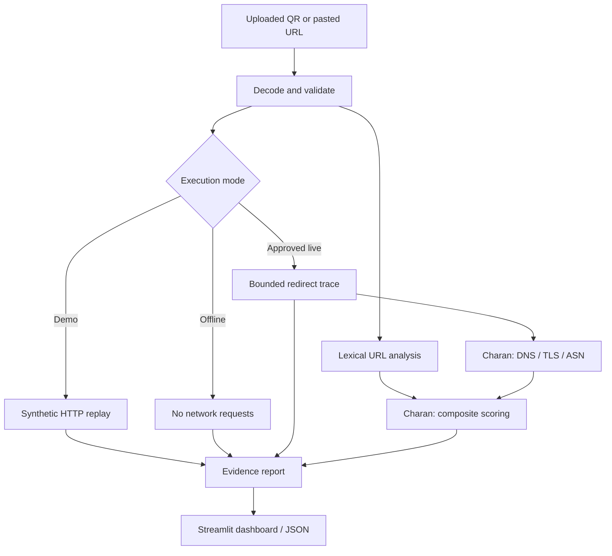

# Review 2 — Fadhil's milestone

## Actual scope

This milestone implements QR image decoding, URL normalization and lexical analysis, bounded HTTP redirect tracing, UI/CLI integration, and tests. It does **not** complete the whole project's proposed 70% milestone: Charan must supply network evidence and composite scoring before the integrated Review 2 pipeline is complete.

Repository: https://github.com/Fadhil0315/CN-qr-phishing. Fadhil's initial implementation is tracked on `fadhil/input-redirect-ui`; Charan's network/scoring contribution remains separate. This initial commit records the completed local build, not an invented earlier development history.

## Architecture

Charan's boxes are pending integration. The current application renders a null final score and explains missing modules. Synthetic demos never call live network analysis.

## What to demonstrate

1. Start the dashboard. Select Ordinary destination and analyze it: actual QR decoding, normalized URL, no lexical findings, synthetic terminal HTTP response, and explicit pending final score.
2. Select Misleading domain + redirect: show the brand embedded in a misleading subdomain, registered-domain change, HTTPS-to-HTTP downgrade, and explanations. The .test URLs are never contacted.
3. Select Redirect loop: show an incomplete chain and the reason it stopped.
4. Upload examples/ordinary.png with live mode off. Show the same QR decoding path operating on an uploaded file.
5. Paste a non-HTTP value or upload an image without a QR. Show a specific input error instead of a fabricated score.
6. If internet is available, paste https://example.com/ and enable live tracing for the default exact-host list. Show the observed status or an explicit connection failure. Do not promise a particular website response in advance.
7. Download evidence JSON and show the test report. Each member should later demonstrate their own modules separately.

## The six review requirements

| Requirement | Evidence for this milestone |
|---|---|
| Detailed design | Architecture above, interfaces.md, raw observation and finding separation, documented rules, explicit mode boundaries |
| Working progress | Runnable dashboard/CLI, decoder, lexical rules, redirect tracer, automated test results; network and composite scoring marked pending |
| Design justification | OpenCV for local decoding without a separate ZBar system install; Pillow for bounded image loading; PSL-aware hostname parsing; rule explanations; urllib3 for explicit IP-pinned requests; Streamlit for a local Python UI |
| Updated feasibility | Existing laptop, no new hardware/hosting required; actual paid-service use: none in this milestone. Development time and network availability remain practical constraints. Avoid claiming a fully free final ASN provider before Charan chooses it |
| Problems/adaptation | Record real setup, test, and integration issues in contributions.md. Distinguish anticipated threats from failures actually observed |
| Individual contribution | Module ownership and actual work log now; authored commits and mutual PR review after repository setup. No retrospective invented history |

## Remaining work

Before the integrated Review 2 milestone: Charan's DNS, TLS, ASN collectors, network scoring, composite scoring; joint integration and real network evidence review.

Review 3: evaluation on a labelled corpus with separate tuning/test cases, layer comparison, calibration, batch mode, image robustness/webcam, caching/performance work, and exploratory QR structural features. Structure has a provisional 5% planned weight; no feature has yet been shown to predict phishing.

## Practical limitations

Heuristic rule weights are illustrative engineering choices. No accuracy result follows from the synthetic examples. Matching a brand string is not proof of impersonation. An HTTP endpoint can legitimately redirect across domains. HTTP errors indicate a reached response, not a successful or trustworthy webpage. A completed trace covers HTTP Location headers only.

Live tracing uses a checked total operation budget and finite connect/read timeouts. It is not an OS-enforced hard wall-clock deadline against a server deliberately trickling headers. Do not expose this local prototype as a public scanner.

No extra hardware is purchased. Existing electricity/internet and developer time still have costs. Local processing avoids sending QR images to a third-party service; live HTTP/DNS requests still reveal destination queries. Keep private URL tokens out of shared screenshots/exports.
